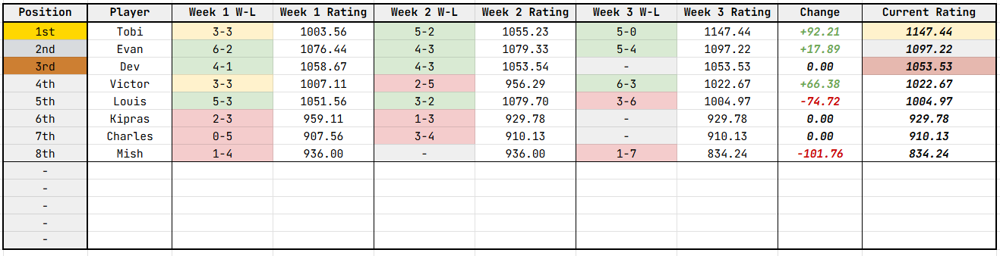
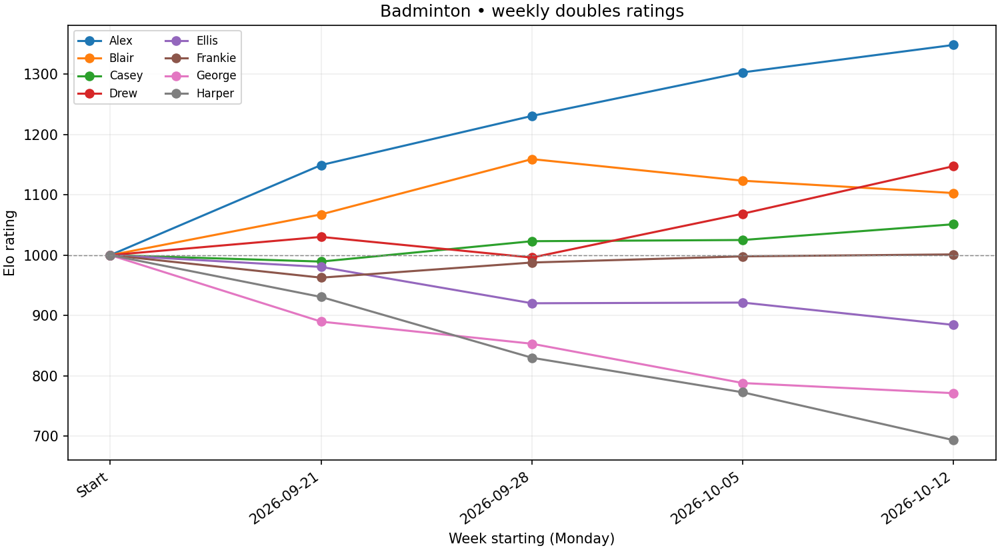

# rankington

An Elo-based engine for ranking players, analysing results, and generating match schedules for my badminton group.

Written in Python, using FastAPI and SQLite.

Jump to a section:

- [Run the engine locally](#local-use)
- [Use the API](#api-use)
- [See weekly insights](#insights-and-graphs)
- [View the CSV format](#csv-format)
- [See the Elo formulae](#elo-formulae) and [understand score margins](#margins)
- [See credits and references](#credits-and-references)

## Current Spreadsheet Image



> Last updated `31.10.26` by `@toblobs`.

## Quick Start

Requires Python **3.11 or newer**. Run the commands from the project root, which contains `pyproject.toml` and the `src` package.

The default database is created at `data/badminton.sqlite3`.
The engine supports both local command-line use and API access.

### Local Use

#### Linux (Bash)

```bash
python -m venv .venv
source .venv/bin/activate
python -m pip install -e '.[test]'
export BADMINTON_ADMIN_KEY='replace-with-a-long-random-secret'
python -m uvicorn src.api:app --host 127.0.0.1 --port 8000
```

#### Windows (PowerShell)

```powershell
python -m venv .venv
.\.venv\Scripts\Activate.ps1
python -m pip install -e ".[test]"
$env:BADMINTON_ADMIN_KEY = "replace-with-a-long-random-secret"
python -m uvicorn src.api:app --host 127.0.0.1 --port 8000
```

Replace the example API key before using the server. Once it is running, open [the interactive FastAPI documentation](http://127.0.0.1:8000/docs).

The server occupies the terminal while it is running. To use the CLI at the same time, open another terminal in the project root and activate the same virtual environment. The CLI can also run without the API server.

#### Register players and import results

Register player names before importing matches. The following commands use `src/cli.py`:

```bash
python -m src.cli add-players Alex Blair Casey Drew Ellis Frankie George Harper
python -m src.cli import 2026-10-19 data/week1.csv --preview
python -m src.cli import 2026-10-19 data/week1.csv
python -m src.cli leaderboard
```

Replace the example names, date, and CSV path with your own. The second command previews the **weekly import** without changing the database. The third command commits it.

#### Recalculate ratings

To apply the current rating model to the stored history, first create a backup. Then preview and commit the recalculation:

```bash
python -m src.cli backup backups/before-rerating.sqlite3
python -m src.cli rerate --preview
python -m src.cli rerate
```

Rerating rebuilds the ratings from the original 1000-point baselines. It does not award the same points twice. It preserves the K values already stored for each week.

#### Correct an earlier week

First create a backup, then upload the **complete corrected week**:

```bash
python -m src.cli backup backups/before-correction.sqlite3
python -m src.cli import 2026-10-19 corrected-week1.csv --replace --preview
python -m src.cli import 2026-10-19 corrected-week1.csv --replace
```

The correction replaces that week's matches and rebuilds the derived ratings, including later weeks whose opening ratings are affected. Backup commands refuse to overwrite an existing destination, so use a new filename for each backup.

### API Use

The API routes are defined in `src/api.py`.

| Method | Path | Purpose |
|---|---|---|
| GET | `/health` | Check service and database readiness |
| GET | `/players` | List registered names and permanent IDs |
| POST | `/players` | Register a player, for example `{ "name": "Alex" }` |
| GET | `/weeks` | List imported weeks, match counts, and model settings |
| POST | `/weeks/{week}/import` | Import a complete new week's CSV |
| PUT | `/weeks/{week}/import` | Replace a complete existing week's CSV and recalculate affected ratings |
| GET | `/leaderboard` | Get latest ratings, tied ranks, total games, and latest weekly statistics |
| GET | `/leaderboard?week=2026-10-19` | Get historical weekly standings |
| GET | `/players/{player_id}/history` | Get a player's weekly rating history and initial 1000 rating |
| GET | `/matches?week=2026-10-19` | Get results and per-match calculations |
| GET | `/weeks/{week}/insights` | Get rating and rank changes, partnerships, opponents, and upsets |
| POST | `/ratings/recalculate` | Recalculate all weeks under a selected model, optionally previewing |
| POST | `/schedule` | Generate partner rotations or Elo matchups |
| GET | `/charts/ratings.svg?player_ids=ID1&player_ids=ID2` | Get a rating chart as SVG |
| GET | `/charts/ratings.png?player_ids=ID1&player_ids=ID2` | Get a rating chart as PNG |

Replace `{week}` with an ISO Monday date and player ID placeholders with permanent IDs returned by `/players`.

Creating the FastAPI app object alone does not initialise the database - starting the server does. CLI commands initialise the database when they open it.

All `POST` and `PUT` routes require the header `X-API-Key: YOUR_SECRET`. If the server's admin key is not configured, protected requests fail with `503`. A missing or incorrect client key returns `401`.

Reads are unauthenticated. `/matches` supports `limit` (1–1000, default 100) and `offset` for pagination.

In a leaderboard response, `games`, `wins`, `losses`, `points_for`, and `points_against` describe the selected or latest week. `total_games` is cumulative. Players with fewer than 20 games are labelled `provisional`; this is a label, not a statistical confidence interval or a different rating formula.

Successful **CSV import** responses return `week`, `status`, and `ratings`. New imports, replacements, and previews also return `recalculated_weeks`. The import status can be `imported`, `replaced`, `preview`, or `already_imported`; an `already_imported` response omits `recalculated_weeks`.

For a CSV preview, add `?preview=true` to the import URL. Set `preview` to `false` to commit. Recalculation responses contain `status` and a `changes` list comparing old and new ratings.

### CSV Format

Use comma-separated CSV files, not semicolon-separated files. For example:

```csv
MatchID,Player1,Player2,Player3,Player4,Team1Score,Team2Score
W1-001,Alex,Blair,Casey,Drew,11,8
W1-002,Alex,Casey,Ellis,Frankie,12,10
W1-003,Blair,Harper,Drew,George,9,11
```

- `Player1` and `Player2` form Team 1; `Player3` and `Player4` form Team 2.
- `MatchID` identifies an actual game and must be unique across the database. Retain the same ID when correcting that game.
- Use these exact column names **in this order**, and save the file as UTF-8.
- Names are matched without regard to case, surrounding whitespace, or repeated whitespace. Players must already be registered.
- Every row requires four **distinct** players.
- Use the Monday date for the week, even if you play on another day. New weeks must be imported chronologically.
- Scores must be integers. Games are first to 11, with a two-point winning margin required and no upper score cap. Ties, unfinished scores such as 11–10, and impossible endings such as 14–10 are rejected.

Typically, you will upload the **complete** results for one week.
There are limits of 2 MiB and 10k matches per upload. Empty lines are ignored.

Uploading the same week again does not apply its rating changes twice. This remains true if you reorder rows, reorder teammates, or swap the two teams together with their scores. Different results for an existing week require an explicit replacement.

### Insights and Graphs

Weekly insights include rating changes, wins and losses, point totals, rank changes from the preceding imported week, upsets, partnership records, and opponent counts.

A positive `rank_change` means the player moved up. New arrivals without previous standings have a `null` rank change. In the first week, players are compared with the initial shared rank of 1.

A connectivity flag indicates whether all participating players were connected through that week's games. Connectivity is useful, but fixed partnerships can still make individual strengths difficult to distinguish.

For interactive charts on websites or in other applications, use the JSON rating histories. For downloadable charts, use the `.png` or `.svg` image endpoints.



> Example generated graph.

### Databases

| Table | Key | Stored information |
|---|---|---|
| `Players` | `player_id` | Permanent ID, display name, normalised unique name, eligibility boundary, and creation time |
| `Weeks` | `week` | Monday date, semantic hash, latest source CSV, K, and timestamps |
| `Matches` | `match_id` | Week, four player foreign keys, and both final scores |
| `Ratings` | `week` + `player_id` | Opening rating, closing rating, change, games, wins, losses, points for, and points against |
| `MatchCalculations` | `match_id` | Opening team averages, expected and actual Team 1 result, raw adjustment, margin multiplier, and final per-Team-1-player adjustment |
| `Metadata` | `key` | Schema version and default rating algorithm |

A player's eligibility boundary is the latest published week when they register. They are included only in subsequent imported weeks, preventing new registrations from appearing in historical standings. Register everyone for week one before importing it.

A new database uses the score-margin model. Opening a populated legacy database upgrades its structure while preserving its existing model and ratings. Use `rerate` to apply the current model to that history explicitly.

## Engine Design

### Elo Formulae

All players start at **1000 Elo**. Every game is first to 11, win by two, with no upper cap.

Freeze every player's published opening-week rating. Given player ratings `A`, `B`, `C`, and `D`, with Team 1 comprising A and B and Team 2 comprising C and D, the calculation is:

```python
K = 32

T1 = (A + B) / 2
T2 = (C + D) / 2

E1 = 1 / (1 + 10 ** ((T2 - T1) / 400))
S1 = 1 if score1 > score2 else 0

margin = abs(score1 - score2)
M = 1 + min(9, max(0, margin - 2)) / 9

raw_delta = K * (S1 - E1)
final_delta = M * raw_delta
```

| Symbol | Meaning |
|---|---|
| `T1`, `T2` | Average opening-week rating of each team |
| `E1` | Expected probability that Team 1 wins |
| `S1` | Actual Team 1 result: 1 for a win, 0 for a loss |
| `M` | Score-margin multiplier, bounded between 1 and 2 |
| `K` | Adjustment factor per player, per game |
| `final_delta` | Rating contribution for each Team 1 player |

> `K = 32` is an arbitrarily chosen value.

For example, suppose A is rated 1200, B is rated 800, and C and D are each rated 1100. The team averages are 1000 and 1100. This 100-point Elo difference gives Team 1 an expected win probability of approximately `0.359935`, or **35.99%**.

Each Team 1 player receives `final_delta`; each Team 2 player receives its negative. Sum each player's contributions over the week and publish one closing rating:

```python
closing_rating = opening_rating + sum(match_contributions)
```

The production code uses `math.fsum()` for more accurate floating-point summation. **Ratings used for expectations do not change during a week.** The next week's calculations use the published closing ratings.

For the same score margin:

- Losing alongside a strong partner against a weaker pair is more surprising and costs more.
- Winning alongside a weaker partner against a stronger pair earns more.

It might be tempting to award B a larger adjustment simply because B is lower rated than A. However, the final score provides no evidence that B contributed more to that particular victory. Unequal adjustments would introduce an additional assumption; therefore we use equal adjustments which are consistent with both players having equal influence on their team's average rating.

There is currently no inactivity decay. Missing a week leaves a player's rating unchanged.

### Margins

The smallest valid final margin is two, and the largest is eleven. A linear scale assigns a two-point win, such as 11–9, a multiplier of **1×**, and an 11–0 win a multiplier of **2×**.

| Result | Margin | Multiplier | Each winner's gain at equal opening team ratings |
|---|---:|---:|---:|
| 11–9 | 2 | 1.000 | 16.00 |
| 12–10 | 2 | 1.000 | 16.00 |
| 14–12 | 2 | 1.000 | 16.00 |
| 11–8 | 3 | 1.111 | 17.78 |
| 11–7 | 4 | 1.222 | 19.56 |
| 11–5 | 6 | 1.444 | 23.11 |
| 11–3 | 8 | 1.667 | 26.67 |
| 11–0 | 11 | 2.000 | 32.00 |

Each losing player loses the same amount that each winning player gains.

The final score margin controls the multiplier. A 14–12 win receives the same multiplier as an 11–9 win, so going to deuce does not itself earn extra credit.

The legacy win/loss model uses a multiplier of 1 for every game. The current score-margin model uses the formula above.

### Player Rotation

Players on the same team receive identical adjustments, so their rating difference does not change during shared games. When partners rotate, A and B can achieve different results with different teammates, allowing their ratings to diverge.

Players who always partner are difficult to distinguish individually from their results alone. Disconnected playing groups also cannot be compared reliably.

Rotate partners and opponents, and aim for reasonably similar game counts where possible. Contributions are summed rather than averaged, so players with more games have more opportunities for their rating to move.

### Tradeoffs

- Stronger opponents and weaker partners affect the expected result through team-average ratings.
- A win never produces a rating loss, and a loss never produces a rating gain. Extreme numerical saturation can produce a zero adjustment.
- A final team score does not identify each teammate's individual contribution.
- Every game is zero-sum across its four players. With all players starting at 1000 and no removals or manual adjustments, the total rating remains approximately `1000 * n`, where `n` is the number of registered players.
- Margin weighting increases the effective adjustment factor from 32 up to 64, so decisive results move ratings faster.
- There is **no guarantee of unbiased skill estimates**. Favourites tend to win more decisively, so score weighting can distort individual ratings and the rating spread. A calibrated model would require more data.

## Credits and References

`@toblobs` for main engine design.

Project contributors:

[](https://github.com/Toblobs/rankington/graphs/contributors)

-----

References
- [JetBrains Mono font](https://fonts.google.com/specimen/JetBrains+Mono).
- [Microsoft TrueSkill project](https://www.microsoft.com/en-us/research/project/trueskill-ranking-system/).
- [FiveThirtyEight on margin multipliers](https://fivethirtyeight.com/methodology/how-our-nfl-predictions-work/).
