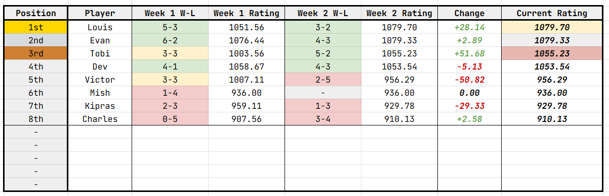

# rankington

An ELO-like engine tasked with ranking, analysing and generating for my badminton group.
Written entirely with Python, FastAPI and SQLite3.

Jump to parts of the project explanation:
 - [Run the engine locally](#local-use)
 - [Connect to an API](#api-use)
 - [See weekly insights](#insights-and-graphs)
 - [Example of a CSV for one week](#csv-format)
 - [See the underlying formulae](#elo-formulae) and [understand score margins](#margins)
 - [See credits & references](#credits-and-references)

## Current Spreadsheet Image


> Last updated `31.10.26` by @toblobs.

## Quick Start

Requires Python `3.11` or newer.
The production database is created at `data/badminton.sqlite3`.
The engine has been written to support both local use and API use.

### Local Use

<style type="text/css">
.tg  {border-collapse:collapse;border-spacing:0;}
.tg td{border-color:black;border-style:solid;border-width:0px;font-family:Arial, sans-serif;font-size:14px;
  overflow:hidden;padding:10px 5px;word-break:normal;}
.tg th{border-color:black;border-style:solid;border-width:0px;font-family:Arial, sans-serif;font-size:14px;
  font-weight:normal;overflow:hidden;padding:10px 5px;word-break:normal;}
.tg .tg-0pky{border-color:inherit;text-align:left;vertical-align:top}
.tg .tg-6a0s{border-color:inherit;border-width:1px;text-align:left;vertical-align:top}
</style>
<table class="tg"><thead>
  <tr>
    <th class="tg-0pky">Platform</th>
    <th class="tg-0pky">Command</th>
  </tr>
</thead>
<tbody>
  <tr>
    <td class="tg-0pky"><span style="font-style:italic">Linux</span></td>
    <td class="tg-6a0s"><br>```bash<br>python -m venv .venv<br>source .venv/bin/activate<br>python -m pip install -e '.[test]'<br>export BADMINTON_ADMIN_KEY='replace-badminton-api-admin-secret'<br>python -m uvicorn src.api:app --host 127.0.0.1 --port 8000<br>```<br></td>
  </tr>
  <tr>
    <td class="tg-6a0s"><span style="font-style:italic">Windows</span></td>
    <td class="tg-6a0s">- Activate with `.venv\Scripts\Activate.ps1`<br>- Install with `python -m pip install -e ".[test]"`<br>- Set admin key by using `$env:BADMINTON_ADMIN_KEY="replace-badminton-api-admin-secret"`</td>
  </tr>
</tbody>
</table>

Register your names before you import anything.

The following commands rely on `src > cli.py` commands.

To add some players and view a leaderboard:

```bash
python -m src.cli add-players Alex Blair Casey Drew Ellis Frankie George Harper
python -m src.cli import 2026-10-19 data/week1.csv --preview
python -m src.cli import 2026-10-19 data/week1.csv
python -m src.cli leaderboard
```

Here, the second command allows you to preview what a rerate will do.
This is intended for *algorithm changes* (currently not implemented).

To *recalculate* the scores for a given database, first backup:

```bash
python -m src.cli backup backups/my-backup.sqlite3
python -m src.cli rerate --preview
python -m src.cli rerate
```

To *correct* an earlier week, also backup:

```bash
python -m src.cli backup backups/before-correction.sqlite3
python -m src.cli import 2026-10-19 corrected-week1.csv --replace --preview
python -m src.cli import 2026-10-19 corrected-week1.csv --replace
```

### API Use

These rely on `src > api.py`.

| Method | Path | Purpose |
|---|---|---|
| GET | `/health` | Service/database readiness |
| GET | `/players` | Registered names and permanent IDs |
| POST | `/players` | Register `{ "name": "Alex" }` |
| GET | `/weeks` | Imported weeks, match counts and model settings |
| POST | `/weeks/{week}/import` | Import a complete new week's CSV |
| PUT | `/weeks/{week}/import` | Replace a complete existing week's CSV (and replay later weeks) |
| GET | `/leaderboard` | Latest ratings, tied ranks, total games and latest weekly statistics |
| GET | `/leaderboard?week=2026-10-19` | Historical weekly standings |
| GET | `/players/{id}/history` | Weekly rating timeline and initial 1000 rating |
| GET | `/matches?week=2026-10-19` | Results and per-match calculation audit |
| GET | `/weeks/{week}/insights` | Rating/rank changes, partnerships, opponents and upsets |
| POST | `/ratings/recalculate` | Recalculate all weeks under a selected model, optionally previewing |
| POST | `/schedule` | Generate partner rotations or ELO matchups |
| GET | `/charts/ratings.svg?player_ids=ID1&player_ids=ID2` | Rating chart as SVG |
| GET | `/charts/ratings.png?player_ids=ID1&player_ids=ID2` | Rating chart as PNG |

Creating the FastAPI app object alone does not also create the database (start the server to do this).

All `POST` and `PUT` routes require `X-API-Key: YOUR_SECRET`. If not configured, writes fail with `503`.
Reads are unauthenticated. `/matches` uses `limit` (`1` - `1000`, default of `100`) and `offset` as further pages are needed.

In a leaderboard response, `games`, `wins` and `losses`, as well as points, are the statistics for the selected or latest week. `total_games` is cumulative, and players below `20` games are labelled as `provisional`.

Successful responses should return `week`, `status`, `ratings` and `recalculated_weeks`.
Statuses can include `imported`, `replaced`, `preview` or `already_imported`.

### CSV Format

An example CSV for a week of matches is shown below.
Use comma-separated CSVs, not semicolon-separated.

```csv
MatchID,Player1,Player2,Player3,Player4,Team1Score,Team2Score
W1-001,Alex,Blair,Casey,Drew,11,8
W1-002,Alex,Casey,Ellis,Frankie,12,10
W1-003,Blair,Harper,Drew,George,9,11
```

- `Player1` and `Player2` form `Team1`, and `Player3` and `Player4` form `Team2`.
- `MatchID` identifies an actual game and therefore must be unique across the entire database.
- The engine expects these exact column names encoded in UTF-8. 
- Player names ignore case and whitespace. Players must be registered.
- Every row required four *distinct* players
- Use the Monday date for a week, even if you play on another day. New weeks must be chronological.
- Scores must be integers and are first-to-11. The exception is deuces (10-10) which must go two points clear. Ties, unfinished 11-10s, and impossible endings (e.g. 14-10) are rejected.

Typically, you will upload the **complete** results for one week.
There are limits of 2 MiB and 10k matches per upload. Empty lines are ignored.
Reuploaded weeks should be safe, including row reordering and teammate reordering.

### Insights and Graphs

Weekly insights include ratings gained/lost, games won/lost, point totals, rank changes from last week, upset results, partnership records and opponent counts. Positive `rank_change` means moving up (new arrivals have a null rank movement).

A connectivity flag warns whether all the players in the week were connected through the week's games.
Being connected is useful, but fixed partners can still confound estimated.

To use charts in websites or other applications, use JSON history. For downloadable charts, use image endpoints (which will soon be more configurable). Endpoints require either `.png` or `.svg`


> Example generated graph.

### Databases

| Table | Key | Stored information |
|---|---|---|
| Players | player_id | Permanent ID, display name, normalised unique name, eligibility boundary, creation time |
| Weeks | week | Monday date, semantic hash, latest source CSV, K, timestamps |
| Matches | match_id | Week, four player foreign keys, both final scores |
| Ratings | week + player_id | Opening rating, closing rating, delta, games, wins, losses, points for/against |
| MatchCalculations | match_id | Opening team averages, expected/actual Team 1 result, per-Team-1-player delta |
| Metadata | key | Schema version |

Eligibility is recorded as the latest published week when a player registered, and this player is only included in subsequent imported weeks. This avoids new registrations appearing in the past.

## Engine Design

### ELO formulae

All players start at **1000** ELO. Every game is first-to-11, win-by-two with no upper cap.

First, we freeze every player's published opening-week rating. 
Given player ratings `A`, `B`, `C`, `D` and teams [`A`, `B`] vs [`C`, `D`]:
```
T1 = (A + B) / 2
T2 = (C + D) / 2

E1 = 1 / (1 + 10 ** (T2 - T1) / 400)
S1 = 1 if T1 wins else 0
M = 1 = min(9, max(0, abs(score1 - score2) - 2))  / 9
raw-Δ = K(S1 - E1)
final-Δ = M * raw-Δ
```

`K` is chosen as `32` relatively arbitrarily. 
A constant `K` means there is no inflation or deflation from assigning different `K` factors to teammates.

Imagine if `A` was rated `1200`, `B` rated `800`, `C` rated `1100` and D also `1100`.
Team averages are `1000` and `1100`. This 100 point ELO difference gives Team 1 a prediction of `0.35993..`, or a `35.9%` chance of winning.

Each Team 1 player recieves `final-Δ` and each Team 2 player its negative.
Sum all contributions over a week of games, and publish a new rating once per player-week.
It is important to understand that scores do not update *during* a week.

Differences in strength are accounted for as follows:
- Losing beside a strong partner to a weak pair is more surprising and costs more.
- Winning beside a weak parnter against a strong pair earns more.

It is tempting to award `A` more simply because `B` is lower rated - but the final score contains no evidence `B` contriubuted more to a specific victory.
This weighting would add a separate assumption to the model. Equal changes are also consistent with the equal sensitivity of the teams ratings. 

Also, there is nmo inactivity decay (may be changed).

### Margins

The smallest valid final margin is two, anmd the largest is eleven.
A linear scale anchors the closest result (11 - 9) to `1x` and the farthest (11 - 0) to `2x`.

| Result | Margin | Multiplier | Each winner's gain at equal opening ratings |
|---|---:|---:|---:|
| 11–9 | 2 | 1.000 | 16.00 |
| 12–10 | 2 | 1.000 | 16.00 |
| 14–12 | 2 | 1.000 | 16.00 |
| 11–8 | 3 | 1.111 | 17.78 |
| 11–7 | 4 | 1.222 | 19.56 |
| 11–5 | 6 | 1.444 | 23.11 |
| 11–3 | 8 | 1.667 | 26.67 |
| 11–0 | 11 | 2.000 | 32.00 |

Final score margin controls this factor, so a (14 - 12) win receives the same multiplier as (11 - 9).
This is so that games going to a deuce don't get extra credit.

### Player Circulation

As players on the same team receive the same adjustment, their difference doesn't change between shared games. When partners rotate, `A` may win with different people than `B`, causing divergence. Therefore players who always partner disadvantage the model, and disconnected playing groups cannot be compared reliably.

Rotation of partners is therefore important, and game counts across weeks should be similar if possible.

### Tradeoffs

The engine has some benefits and drawbacks to consider:
- Stronger opponents and weaker partners affect team expectiations. 
- A win never produces a rating loss, a loss never produces a rating gain.
- Contributions to a win are unidentifiable based off the score.
- Every game is zero-sum across the four players. The sum of everyone's ratings will always be `1000n` where `n` is number of players in the pool (apart from floating-point noise).
- There is **not** a garauntee of unbiased skill estimates, especially as favourites tend to win more decisively. Individual favourite or underdog bias can distort rating spread, and a better model would require more data.

## Credits and References

- @toblobs for main engine design
- JetBrainsMono Font
- Microsoft TrueSkill project: https://www.microsoft.com/en-us/research/project/trueskill-ranking-system/
- FiveThirtyEight on margin multipliers: https://fivethirtyeight.com/methodology/how-our-nfl-predictions-work/
